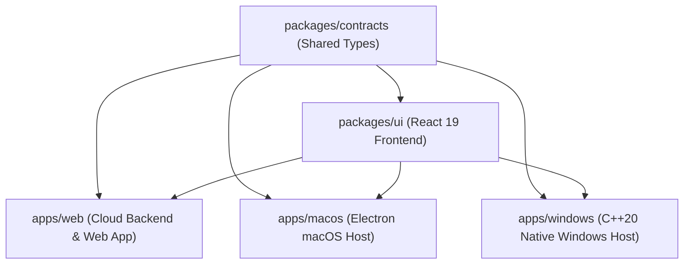

# LensDesk 2.0 — Repository Architecture Audit & Three-Platform Parity Plan

**Document Version**: 1.0.0-PLAN  
**Date**: October 29, 2026  
**Auditor**: Antigravity Native Systems Engineering Team  
**Scope**: Complete Workspace Discovery, Three-Platform Separation (Web, macOS, Windows), and HintLens Reference Parity Roadmap.  
**Execution State**: **Inspection & Proposal Phase Only** — No files modified, moved, or deleted.

---

## Executive Summary

The LensDesk repository currently suffers from duplicate directory checkouts (`lensdesk-reviewed-1.3.6` vs `LensDesk2.0`), entangled build targets in a single root `package.json`, and mixed platform code paths where macOS Electron scripts and Windows native C++ components sit side-by-side.

This proposal establishes a clean, decoupled, maintainable **Three-Platform Architecture** within a single unified **LensDesk 2.0** repository:
1. **LensDesk 2.0 Web Application** (`apps/web`): Cloud APIs, account services, Stripe billing, PostgreSQL persistence, and browser dashboard.
2. **LensDesk 2.0 macOS Application** (`apps/macos`): Electron macOS desktop host with Cocoa windowing, Apple Silicon/Intel packaging, and macOS ScreenCaptureKit/Quartz integrations.
3. **LensDesk 2.0 Windows Application** (`apps/windows`): Pure C++20 Win32 host (`RuntimeHost.exe` / `TiWorker.exe`), Direct3D 11 transparent overlay, DirectComposition, Win32 hooks, and NSIS portable packaging targeting **100% HintLens Parity**.
4. **Shared Packages** (`packages/ui` and `packages/contracts`): Reusable React 19 UI widgets and strictly typed IPC contracts without cross-platform contamination.
5. **HintLens Reference Archive** (`reference/`): Immutable reference binaries (`TiWorker.exe`), reverse-engineering evidence, and extraction scripts.

---

## 1. Current Repository Assessment & Verified Inventory

### 1.1 Physical File System Layout (Discovered)
At `/Users/vivek/new repo/`, the following top-level entities currently exist:

| Entity Name | File System Type | Git Status / Remote | Verified Purpose & Contents |
|---|---|---|---|
| `lensdesk-reviewed-1.3.6` | Physical Directory | Active Git (`origin`, `helpdesk`) | Primary active development directory containing all source code, `node_modules`, `src-native/`, `desktop/`, `server/`, and `dist/`. |
| `lensdesk` | Symbolic Link | Symlink to `lensdesk-reviewed-1.3.6` | Canonical alias established by legacy `AGENTS.md`. |
| `LensDesk2.0` | Physical Directory | Separate Git clone (`origin`, `helpdesk`) | **Duplicate repository checkout** sharing identical remotes. Currently mirrors `lensdesk-reviewed-1.3.6` but has slight asset hash drift in `dist/`. |
| `archives` | Physical Directory | Unversioned Archive | Contains legacy source zip files, pre-consolidation tarballs (`2026-10-20`), and legacy manifest. |
| `research` | Physical Directory | Research Workspace | Contains HintLens static artifacts (`TiWorker.exe` 2.1 MB, `HintlensApp.zip`), REA setup plans, and `FINDINGS.md`. |
| `rea` | Physical Directory | Submodule / Tool | REA (Reverse-Engineering Agents) MCP CLI tool repository. |
| `windows-handoff-1.3.6` | Physical Directory | Archive / Hand-off | Contains static handoff ZIPs (`LensDesk-1.3.6-Windows-x64.zip`) and legacy handoff scripts (`RUN-V7.bat`). |
| `lensdesk-legacy` | Physical Directory | Legacy Fragment | Contains an isolated copy of `desktop/main.cjs`. |

### 1.2 Internal Module Inventory (Inside Active Source)
Inspecting `lensdesk-reviewed-1.3.6`:

- **`server/`** (Web Application & Backend):
  - `server/cloud/app.mjs`: Central HTTP/HTTPS web server, REST API routing, webhook handling, and rate limiting.
  - `server/cloud/postgres-store.mjs` & `postgres-db.mjs`: Production PostgreSQL storage engine (Neon/Postgres) managing users, subscriptions, devices, and sessions.
  - `server/cloud/auth.mjs`: Local SQLite credential engine with scrypt hashing.
  - `server/cloud/billing.mjs` & `payments.mjs`: Stripe and payment gateway checkout/webhooks.
  - `server/cloud/desktop-sessions.mjs`: Single-seat desktop device acquisition engine.
- **`desktop/`** (macOS Desktop Application / Electron Runtime):
  - `desktop/main.cjs`: Electron application entry point. Creates frameless, transparent BrowserWindow with `LSUIElement: false`.
  - `desktop/preload.cjs`: IPC bridge exposing `window.lens` APIs.
  - `desktop/capture.cjs`: macOS desktop capturer using Quartz/Electron `desktopCapturer`.
  - `desktop/global-keys.cjs`: Global shortcut listener using `uiohook-napi`.
  - `desktop/browser.cjs`: Secondary Electron WebContents browser session.
- **`src-native/`** (Windows Native Application / C++20):
  - `src-native/src/main.cpp`: Win32 `wWinMain` entry point, single-instance mutex (`Local\TiWorker_SingleInstance_Mutex`), Direct3D 11 renderer, DirectComposition engine, and message pump.
  - `src-native/src/window_manager.cpp`: Win32 `SetWinEventHook(EVENT_SYSTEM_FOREGROUND)` and `WM_WINDOWPOSCHANGING` interception for topmost retention; `SetWindowDisplayAffinity(WDA_EXCLUDEFROMCAPTURE)` for stealth.
  - `src-native/src/capture_service.cpp`: GDI `BitBlt` capture + WIC PNG encoding (`WICBitmapIgnoreAlpha`) with active cursor monitor detection (`MonitorFromPoint`).
  - `src-native/src/input_manager.cpp`: Win32 `SendInput` auto-typing engine and global hotkeys.
  - `src-native/src/service_dispatcher.cpp`: IPC bridge routing WebView2 messages.
  - `src-native/src/cloud_client.cpp`: WinHTTP HTTPS client for desktop login and heartbeats.
  - `src-native/src/browser_tabs.cpp`: Embedded WebView2 browser tabs manager.
- **`src/`** (Shared React 19 Frontend UI):
  - `src/main.tsx`: Root React component handling views, state synchronization, hotkeys, and mode routing.
  - `src/OverlayView.tsx`: Overlay shell, minimal mode, full split-screen, and compact interview ticker.
  - `src/Browser.tsx`: Browser toolbar, tab bar, URL input, zoom, and `handlePasteBundle`.
  - `src/FloatingGate.tsx` & `src/GateAccess.tsx`: Login-first desktop gate and authentication card.
  - `src/RegionCapture.tsx` & `src/RadialActionWheel.tsx`: Interactive region cropping and mouse gesture wheel.
- **`installer/`** (Windows NSIS Packaging):
  - `installer/portable-tiworker.nsi`: Compiles HintLens-style standalone executable `TiWorker.exe`.
  - `installer/installer.nsi`: Compiles setup installer `LensDesk-Setup.exe`.
- **`scripts/`** (Packaging & Test Automation):
  - 41 scripts coordinating Vite builds, electron-builder macOS DMGs, Windows single-file ZIP packaging, and integrity audits.

---

## 2. Latest-Version Assessment

### 2.1 LensDesk 2.0 Versions
- **Current Version Tag**: `2.0.0` (in `package.json` and PE resource tables).
- **Git Head**: Commit `666662b` on both `helpdesk/main` (`vision2095/HelpDesk`) and `origin/main` (`VivekGitNinja/LensDesk2.0`).
- **Web Application**: Live deployed at `https://helpdesk-h44x.onrender.com`. Verified responsive (HTTP 200).
- **Windows Application**: `release/TiWorker.exe` (1,045,352 bytes) and `release/LensDesk-2.0.0-Windows-x64.zip` (1,030,189 bytes, SHA256: `1429f394...`). Built from C++20 source with DirectComposition and Win32 hooks.
- **macOS Application**: `release/LensDesk-2.0.0-macOS-Apple-Silicon-arm64.dmg` (141,356,188 bytes) and Intel `release/LensDesk-2.0.0-macOS-Intel-x64.dmg`. Built with Electron 44.9.3.

### 2.2 HintLens Reference Versions
- **Windows Reference**: `research/hintlens-static-20261017/TiWorker.exe` (2,128,384 bytes, PE32+ x86-64 GUI, Linker timestamp: `Mon Oct 5 05:44:45 2026`). Fully extracted and audited (13,373 unique strings).
- **Web Reference**: `https://hintlens.com/` (Public cloud dashboard, billing checkout, device claiming API, history review).
- **macOS Reference**: HintLens has no official macOS release; HintLens is Windows-native. LensDesk macOS achieves functional parity by implementing identical overlay layouts, audio workflows, and AI solving via Cocoa/Electron.

---

## 3. Proposed LensDesk 2.0 Directory Architecture

To eliminate confusion, resolve duplicate checkouts, and give each platform an independent, discoverable home, the repository will be restructured into a modular **Monorepo Architecture** inside `LensDesk2.0/`:

```
LensDesk2.0/
├── apps/
│   ├── web/                          # [PLATFORM 1] LensDesk 2.0 Web Application
│   │   ├── server/                   # Backend Node/Postgres API (app.mjs, auth, billing, sessions)
│   │   ├── client/                   # Web-only views (Marketing landing, checkout, account portal)
│   │   ├── package.json              # Web dependencies (pg, stripe, nodemailer, zod)
│   │   └── Dockerfile                # Render / Cloud deployment container config
│   │
│   ├── macos/                        # [PLATFORM 2] LensDesk 2.0 macOS Desktop Application
│   │   ├── src/                      # Electron Main process (main.cjs, capture.cjs, global-keys.cjs)
│   │   ├── preload/                  # Secure preload bridge (preload.cjs -> window.lens)
│   │   ├── resources/                # macOS icon.icns, entitlements.plist, background.png
│   │   ├── package.json              # macOS dependencies (electron, uiohook-napi)
│   │   └── electron-builder.yml      # macOS DMG, code signing, and LSUIElement configuration
│   │
│   └── windows/                      # [PLATFORM 3] LensDesk 2.0 Windows Desktop Application
│       ├── src-native/               # Pure C++20 Win32 Host (Direct3D 11, DComp, WebView2)
│       │   ├── src/                  # Implementation (main.cpp, window_manager, capture_service)
│       │   ├── include/              # Headers (common.hpp, service_dispatcher, cloud_client)
│       │   ├── resources/            # Windows app.ico, app.rc, manifest (TiWorker metadata)
│       │   └── CMakeLists.txt        # MSVC / Clang C++20 build definition
│       ├── installer/                # NSIS Packaging Scripts
│       │   ├── portable-tiworker.nsi # Single-file portable TiWorker.exe generator
│       │   └── installer.nsi         # LensDesk-Setup.exe full installer
│       ├── scripts/                  # Windows packaging & verification scripts
│       └── package.json              # Windows build commands (npm run build:win, test:archive)
│
├── packages/
│   ├── ui/                           # Shared React 19 Frontend Application (Embedded in all 3)
│   │   ├── src/                      # OverlayView, Browser, GateAccess, Settings, Theme
│   │   ├── public/                   # Shared UI assets, fonts, icons
│   │   ├── package.json              # React 19, Lucide-React, Vite dependencies
│   │   └── vite.config.ts            # Builds web assets into dist/
│   │
│   └── contracts/                    # Shared TypeScript Types & IPC Schemas
│       ├── src/                      # IPC Action contracts, Gate state, Settings types, API payloads
│       └── package.json              # Type declarations export
│
├── reference/                        # HintLens Reference Baseline & Reverse-Engineering Evidence
│   ├── windows/                      # Reference TiWorker.exe (2.1 MB) & PE inspection data
│   ├── reports/                      # Full gap analysis reports & parity checklists
│   └── scripts/                      # String extractors and REA audit scripts
│
├── release/                          # Verified Production Build Output (Ignored in Git, local/CDN)
│   ├── web/                          # Production web assets
│   ├── macos/                        # Built macOS DMGs
│   └── windows/                      # Built TiWorker.exe, Setup.exe, and Windows ZIPs
│
├── tests/                            # Automated Regression Test Suites
│   ├── web/                          # Cloud APIs, Postgres migrations, Stripe webhooks
│   ├── macos/                        # Electron IPC, display routing, reference workflow tests
│   └── windows/                      # PE signature verification, ZIP archive tests, Win32 contracts
│
├── package.json                      # Workspace Root (pnpm/npm workspaces coordinating all packages)
├── AGENTS.md                         # Unified agent workspace instructions
└── README.md                         # Comprehensive architecture and developer quickstart guide
```

---

## 4. Folder-by-Folder Migration Table

| Existing Location | Proposed New Location | Subsystem / Purpose | Dependencies / Impact | Proposed Action | Technical Reason |
|---|---|---|---|---|---|
| `server/` | `apps/web/server/` | Web Backend & APIs | Node.js, `pg`, `stripe`, `zod` | Move intact | Decouples cloud server from desktop desktop runners. |
| `desktop/` | `apps/macos/src/` | macOS Desktop Runner | Electron, `uiohook-napi` | Move intact | Clarifies that Electron runner is exclusively for macOS. |
| `src-native/` | `apps/windows/src-native/` | Windows C++20 Host | Win32, D3D11, DComp, WebView2 | Move intact | Isolates pure native Windows code from Node/Electron. |
| `installer/` | `apps/windows/installer/` | Windows NSIS Scripts | `makensis`, NSIS lzma | Move intact | Groups Windows packaging with the Windows application. |
| `src/` | `packages/ui/src/` | Shared React 19 UI | React 19, Vite, Lucide | Move intact | Prevents UI duplication across Web, Mac, and Windows. |
| `native/` | `apps/macos/native/` | Native Addon fallback | `node-gyp` | Move or archive | Legacy Node addon; not used by Windows C++ host. |
| `research/` | `reference/` | HintLens Reference Artifacts | Static PE binaries | Rename/Move | Establishes permanent reference baseline directory. |
| `scripts/` | Partitioned into app folders | Build & Test Scripts | Platform-specific | Partition & Refactor | Moves Windows scripts to `apps/windows/scripts/`, etc. |
| `tests/` | Partitioned in `tests/` | Automated Test Suites | Node test runner | Reorganize by platform | Clearly tests Web, Mac, and Windows independently. |
| `lensdesk-reviewed-1.3.6` | Consolidated into `LensDesk2.0/` | Duplicate Source Copy | Git remote | **Consolidate** | Eliminates confusion of having two competing root checkouts. |

---

## 5. Shared versus Platform-Specific Architecture



### 5.1 Genuinely Shared Components
- **`packages/contracts`**: IPC action string constants (`desktop.capture`, `gate.login`, `browser.pasteBundle`), TypeScript types (`State`, `GateView`, `Session`, `Entitlement`), and HTTP schemas.
- **`packages/ui`**: React 19 frontend compiled into `dist/`. Contains `OverlayView.tsx` (HUD layouts), `Browser.tsx` (in-overlay browser view), `FloatingGate.tsx` (login screen), and `Theme.ts`.
  - In Web: Rendered directly in Chrome/Safari/Firefox.
  - In macOS: Rendered in Electron BrowserWindow.
  - In Windows: Rendered in Edge WebView2 with DirectComposition transparency.

### 5.2 Strictly Isolated Platform Code
- **Windows (`apps/windows`)**: Pure C++20. Does not import Electron, `desktopCapturer`, or Cocoa headers. Communicates with UI via `ICoreWebView2WebMessageReceivedEventHandler`.
- **macOS (`apps/macos`)**: Pure Electron/Node. Uses `contextBridge.exposeInMainWorld("lens", ...)`, `uiohook-napi`, and macOS `.dmg` packaging.
- **Web (`apps/web`)**: Pure Node.js/PostgreSQL. Runs headless in cloud containers (Render). Does not load native windowing libraries.

---

## 6. Windows-Specific Safeguards (Preventing macOS Pollution)

To guarantee that the Windows application is never tested or validated using macOS assumptions:

1. **Independent Build Commands**:
   - Web: `npm --workspace=apps/web run dev` / `npm --workspace=apps/web run start`
   - macOS: `npm --workspace=apps/macos run build` / `npm --workspace=apps/macos run dist`
   - Windows: `npm --workspace=apps/windows run build` / `npm --workspace=apps/windows run package`
2. **Explicit Environmental Boundary Statements**:
   - In all Windows test scripts (`windows-archive-check.mjs`, `win-exe-audit.mjs`), output explicitly prints:  
     `[AUDIT LIMITATION]: Running on macOS Darwin. PE verification, CRC checks, and resource signatures validated. Native Win32 execution was not performed on this machine.`
3. **No Cross-Platform Fallback Imports**:
   - Windows build scripts will explicitly reject any imports from `apps/macos/` or `desktop/`.
   - Windows NSIS script will only package binaries from `apps/windows/release/` and web assets from `packages/ui/dist/`.

---

## 7. Three-Application Parity Plan with HintLens

### 7.1 Web Application Parity Plan
- **Baseline**: `https://hintlens.com/` web dashboard.
- **Target Areas**:
  - User registration, verification email, and password reset flows.
  - Subscription checkout via Stripe (prepaid time tokens and subscription renewals).
  - Active device management: listing logged-in desktop devices and allowing one-click device seat revocation.
  - Cloud answer history viewer: displaying saved screenshots, prompts, and AI responses.

### 7.2 macOS Application Parity Plan
- **Baseline**: HintLens functional specification adapted to macOS Cocoa/Quartz.
- **Target Areas**:
  - Borderless floating overlay with `LSUIElement: false` and macOS ScreenCaptureKit exclusion.
  - Minimal portrait mode, standard split-screen, and compact interview ticker.
  - Auto-type simulation using macOS Accessibility API (`CGEventPost`).
  - Screen capture using macOS Quartz display capture with active mouse display targeting.

### 7.3 Windows Application Detailed Parity Plan (Highest Priority)
- **Baseline**: Reference binary `TiWorker.exe` (2.1 MB).
- **Execution Phases**:
  - **Phase 1: Security & Process Management**:
    - Implement `UIAccess` token elevation via `winlogon.exe` duplication (GAP-02) to stay topmost over Task Manager and admin terminals.
    - Implement Focus Drift Loss detection (GAP-06) in `InputManager::AutoTypeWorker` to pause typing if active window changes.
    - Implement silent WebView2 bootstrapper downloader (GAP-03).
  - **Phase 2: Screen Capture & OCR Parity**:
    - Implement native WinRT OCR (`Windows.Media.Ocr`) (GAP-05) for offline text models (Ollama).
    - Multi-monitor dropdown in Settings: Active monitor, All monitors, Specific monitor.
    - Match default hotkeys: `Ctrl+Shift+D` for capture, `Ctrl+Shift+M` for mouse mode, `Ctrl+Shift+G` for browser.
  - **Phase 3: WASAPI Loopback Audio**:
    - Implement native C++ `IAudioCaptureClient` on default render endpoint (`eRender`) with `AUDCLNT_STREAMFLAGS_LOOPBACK` (GAP-08) for true invisible interview audio loopback.
  - **Phase 4: Typing Simulator Humanization**:
    - Implement log-normal latency distribution and punctuation hesitations in native C++ (GAP-07).
  - **Phase 5: Proctoring Defenses & Data Sanitization**:
    - Implement dynamic proctor process monitoring (`LockDownBrowser.exe`, `SafeExamBrowser.exe`) (GAP-04).
    - Implement one-click "Delete Everything & Remove App" self-deleting routine (GAP-12).

---

## 8. Build, Test, and Verification Strategy

| Platform | Build Command | Test & Verification Strategy | Execution Environment |
|---|---|---|---|
| **Web** | `npm --workspace=apps/web run build` | `npm --workspace=apps/web run test` (HTTP unit tests, Postgres integration tests, Stripe webhook validation). | macOS, Linux, or Cloud (Render) |
| **macOS** | `npm --workspace=apps/macos run build` | `npm --workspace=apps/macos run test` (Electron IPC verification, Display capture mock, reference workflow check). | Native macOS |
| **Windows** | `npm --workspace=apps/windows run build` | 1. `npm --workspace=apps/windows run test:archive` (Validates PE signatures, sections, DLL dependencies, NSIS payload).<br>2. Windows VM / Physical PC (Live runtime verification of D3D11 swap chain, hooks, and hotkeys). | Static check on Mac; Runtime on Windows |

---

## 9. Risks and Unresolved Questions

1. **Physical Windows Testing Environment**:
   - *Risk*: Development is taking place on macOS. While PE headers, C++ compilation, and NSIS packaging can be verified on Mac, live testing of Win32 hooks (`SetWinEventHook`, `WDA_EXCLUDEFROMCAPTURE`) requires a Windows runtime or remote Windows test harness.
   - *Remediation*: Maintain strict static verification on Mac and document clear manual/automated Windows test protocols.
2. **Repository Consolidating & Git History**:
   - *Risk*: Having `lensdesk-reviewed-1.3.6` and `LensDesk2.0` side-by-side risks accidental commits to the wrong directory.
   - *Remediation*: Unify everything under the single canonical directory `LensDesk2.0/` once approved.

---

## 10. Phased Implementation Sequence (After Explicit Approval)

1. **Step 1: Workspace Infrastructure Setup**
   - Configure root `package.json` with npm/pnpm workspaces (`apps/*`, `packages/*`).
   - Create directory skeletons: `apps/web/`, `apps/macos/`, `apps/windows/`, `packages/ui/`, `packages/contracts/`, `reference/`.
2. **Step 2: Shared Packages Extraction**
   - Move shared React 19 UI components from `src/` to `packages/ui/`.
   - Extract shared TypeScript types and IPC schemas into `packages/contracts/`.
3. **Step 3: Web Application Migration**
   - Move `server/` into `apps/web/server/`.
   - Setup Web client entry points and Docker deployment configuration.
4. **Step 4: macOS Desktop Application Migration**
   - Move `desktop/` and macOS electron-builder configurations into `apps/macos/`.
   - Verify `npm run dist:mac` builds cleanly.
5. **Step 5: Windows Desktop Application Migration**
   - Move `src-native/`, `installer/`, and Windows packaging scripts into `apps/windows/`.
   - Configure CMake and NSIS scripts to link directly with `packages/ui/dist`.
   - Verify `package-windows-zip.mjs` and `windows-archive-check.mjs`.
6. **Step 6: Reference Baseline Archiving**
   - Move `research/hintlens-static-20261017` and REA analysis into `reference/windows/`.
7. **Step 7: Full Verification & Test Suite Execution**
   - Run complete test suite across Web, macOS, and Windows.
   - Verify zero regression in all 252 tests.

---
*Report archived. Standing by for user review and explicit approval.*
